# Gearshift

**An Aston Martin showroom and car marketplace demo app for Android.**

Gearshift lets you discover, compare and shortlist Aston Martin cars in a cinematic, editorial interface with light and dark themes. It is written in Java with the Android SDK.

<p align="center">
  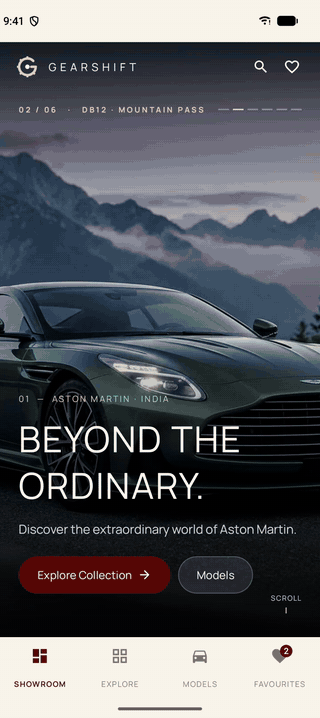
</p>

> **Project status: front-end demo.** The app runs on a built-in sample catalogue of Aston Martin listings.
> There is no backend, so there are no real purchases, payments, accounts or live inventory.
> Test-drive, message and call buttons show a confirmation only.

## Features

- **Showroom:** full-screen photo slideshow, layered model reveals, animated performance gauges and parallax scrolling.
- **Explore:** search, category filters, refinement chips and sorting across the collection.
- **Models:** browse the Vantage, DB12, Vanquish, DBX and Valhalla families.
- **Car details:** front, side and top views, pricing, colours, specs, a torque curve and enquiry options.
- **Favourites:** save cars, compare them side by side, undo a removal and share your shortlist.
- **Light and dark themes** that follow the phone's system setting.

## Screenshots

| Showroom | Model reveal | Performance |
|:---:|:---:|:---:|
| 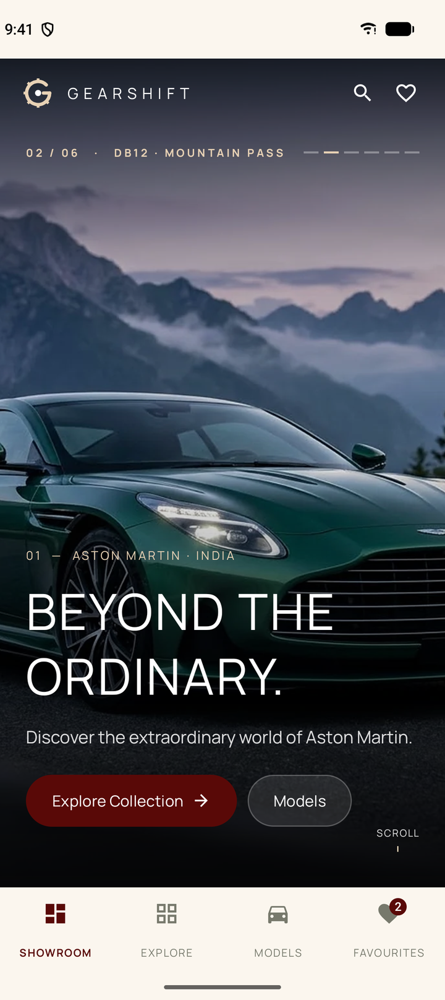 | 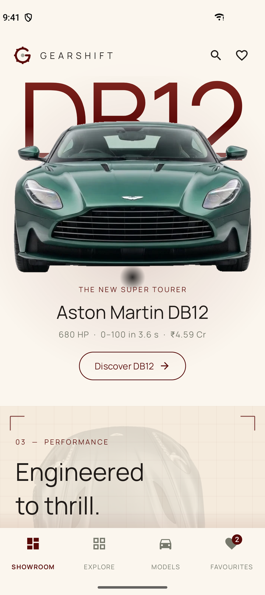 | 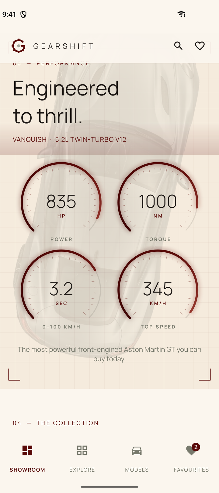 |

| Explore | Car details | Specifications |
|:---:|:---:|:---:|
| 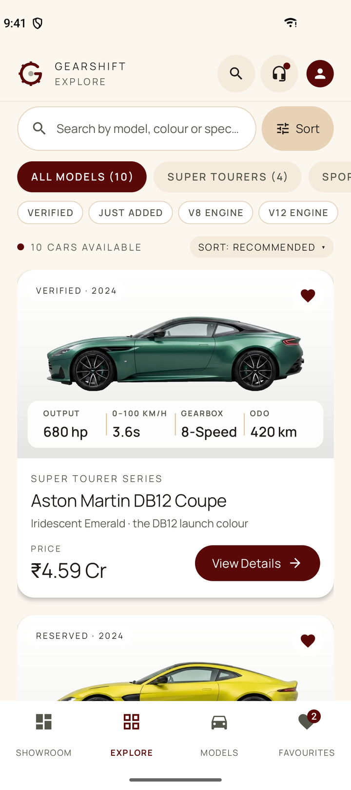 | 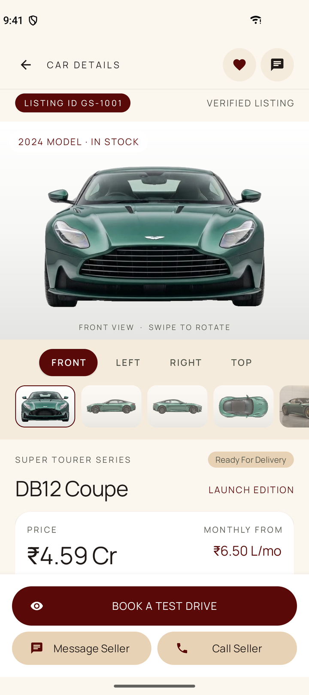 | 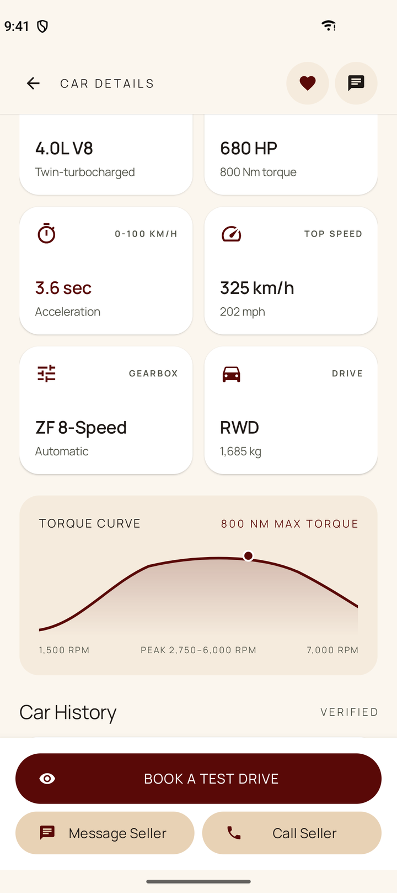 |

| Models | Favourites | Dark theme |
|:---:|:---:|:---:|
| 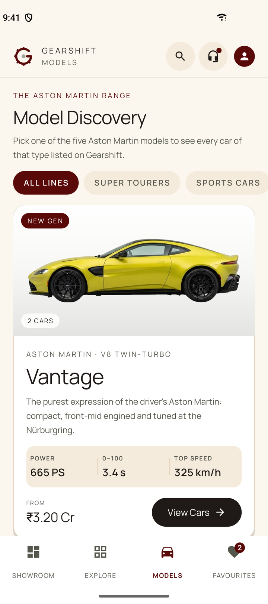 | 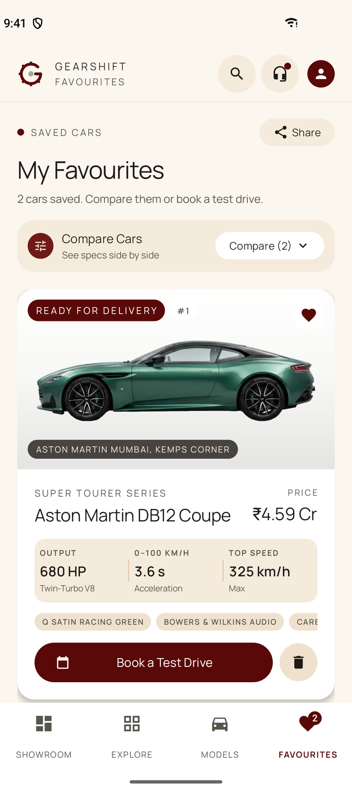 | 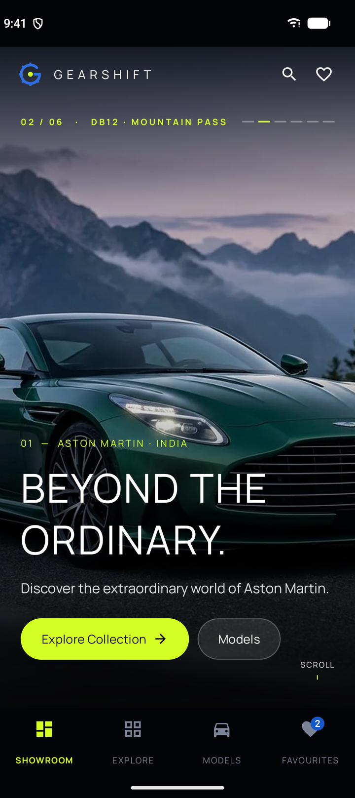 |

<details>
<summary>More dark theme screenshots</summary>

| Performance | Explore | Models |
|:---:|:---:|:---:|
| 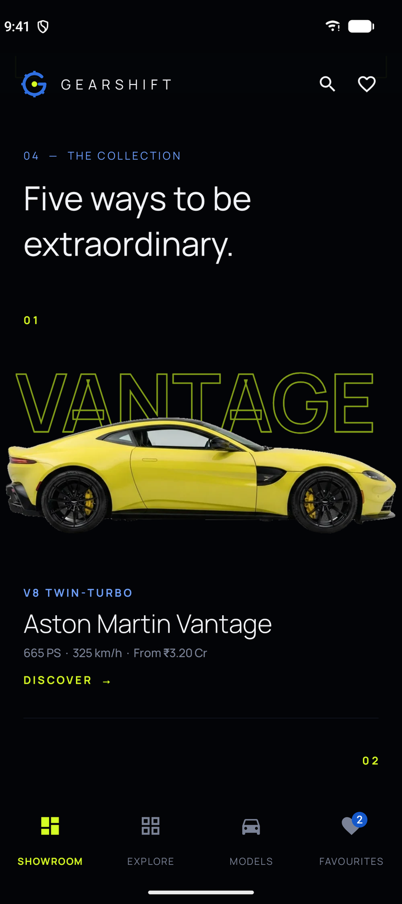 | 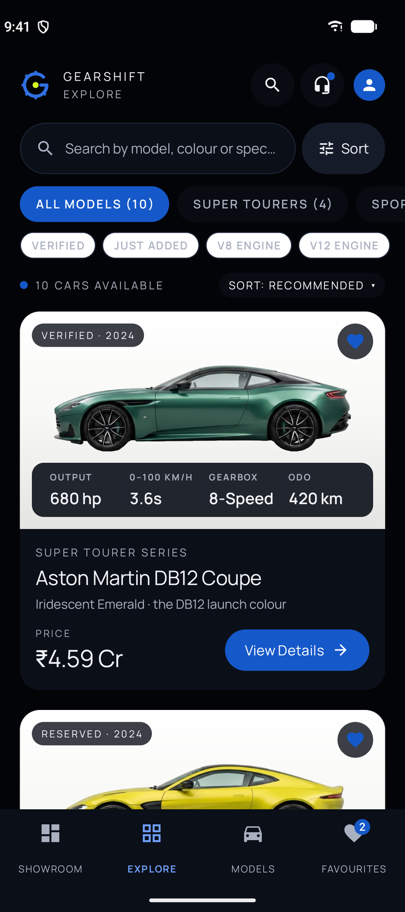 | 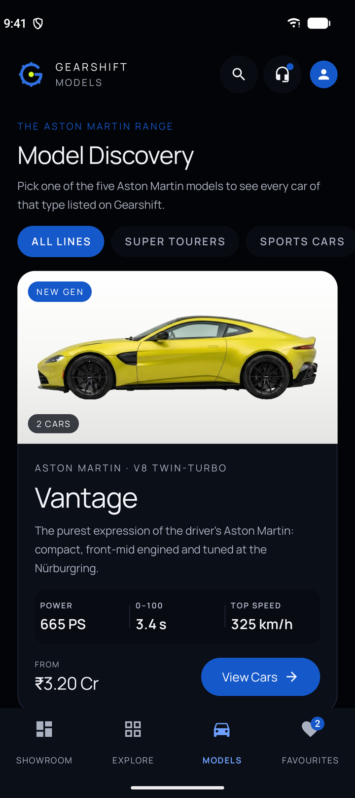 |

</details>

## Demo

- **Video walkthrough (55 s):** [docs/media/demo.mp4](docs/media/demo.mp4)
- **Try it on your phone:** download `gearshift.apk` from the [latest release](../../releases/latest) and install it on Android 8.0 or newer. You may need to allow installs from unknown sources.

## Getting started

Requirements: a recent Android Studio, JDK 17 and Android SDK 37.

1. Clone the repository:
   ```bash
   git clone https://github.com/AayuShen/gearshift-aston-martin-showroom.git
   ```
2. Open the folder in Android Studio and let Gradle sync.
3. Pick an emulator or a connected phone and press **Run**.

To build from the command line instead, run `./gradlew assembleDebug` (or `gradlew assembleDebug` on Windows). The APK is written to `app/build/outputs/apk/debug/app-debug.apk`.

Some photos load over the internet, so the device needs a connection.

## Built with

Java, Android SDK, Material Components and Glide.

## License

The code is released under the [MIT License](LICENSE).

Aston Martin and its model names are trademarks of their owner. Gearshift is an unofficial demo project and is not affiliated with or endorsed by Aston Martin.
